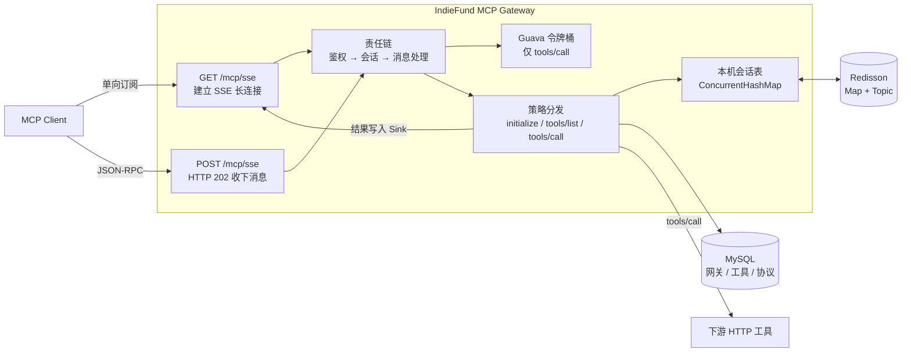

# IndieFund MCP Gateway

独立游戏众筹场景的 MCP 网关。模型客户端只说 MCP，网关按库里的协议配置去调后面的 HTTP 工具，并把结果从原来的长连接推回去。

Maven 坐标是 `com.indiefund.market`，源码包名是 `com.indiefund.mcp`。

## 它解决的问题

- 模型侧要的是 MCP 会话，业务侧已经是普通 HTTP 接口，两边不能绑死在一次请求里。
- 工具调用可能很慢。如果把结果塞进同一条 HTTP 响应，SSE 长连接会被堵住。
- 网关一旦多开，会话不能只活在某一台机器的内存里。
- `tools/call` 会打到下游，必须按 API Key 限流。

## 架构



## 核心链路

一次调用拆成两条通道。

1. 客户端 `GET /api-gateway/{gatewayId}/mcp/sse`，服务端创建会话，并用 SSE 单向推送 `endpoint` 事件。事件里带 `sessionId`。
2. 之后的 JSON-RPC（`initialize`、`tools/list`、`tools/call`）走 `POST /api-gateway/{gatewayId}/mcp/sse?sessionId=...`。
3. POST 只做接收和受理，HTTP 状态是 `202 Accepted`，响应体是空的。
4. 真正的 JSON-RPC 结果写进该会话的 Reactor Sink，从原来的 SSE 连接推回去。

`indie_gw_002` 关闭了鉴权，适合本地把这条链路跑通。`tools/call` 才会进入限流。

## 技术亮点

**SSE 单向推送 + POST 202 异步接收。** 长连接只负责往下推，请求处理不占用这条连接的响应。慢工具调用不会把 SSE 堵死，客户端也不用为了等结果一直占着 POST。

**Redisson 分布式会话。** 本机会话放在 `ConcurrentHashMap`。创建和删除时，把元数据写到 Redis Map `indie_mcp_gw:session:active`，并用 Topic `indie_mcp_gw:session:sync` 广播。其他实例收到 CREATE 时，本地没有才补会话；收到 REMOVE 时只清本地，不再向外广播，避免事件打转。

**责任链 + 策略。** 建连和收消息都是一串节点：根节点、鉴权、会话、消息处理。节点只做一件事，然后交给下一个。JSON-RPC 方法再按策略表分发到 `initialize`、`tools/list`、`tools/call`、`resources/list` 各自的 Handler。协议解析同样按请求体和 query 参数拆成不同策略。

**Guava 令牌桶限流。** 只拦 `tools/call`。额度来自 `mcp_gateway_auth.rate_limit`（次/小时），换算成每秒速率。限流器按网关和 API Key 缓存在本地，一小时没有访问就丢掉。

## 模块

| 模块 | 职责 |
|---|---|
| `ai-mcp-gateway-api` | 对外接口和 DTO |
| `ai-mcp-gateway-trigger` | HTTP 入口：SSE 网关、Streamable 网关、运营接口 |
| `ai-mcp-gateway-case` | 用例编排，责任链节点放在这里 |
| `ai-mcp-gateway-domain` | 会话、鉴权、限流、协议和工具 |
| `ai-mcp-gateway-infrastructure` | MySQL、Redisson、下游 HTTP |
| `ai-mcp-gateway-types` | 错误码和公共类型 |
| `ai-mcp-gateway-app` | 启动模块，默认端口 `8777` |

## 本地运行

依赖 MySQL 8 和 Redis。把样例库导入 `ai_mcp_gateway_v2`：

```bash
mysql -uroot -p < docs/dev-ops/mysql/sql/ai_mcp_gateway_v2.sql
```

编辑 `ai-mcp-gateway-app/src/main/resources/application-dev.yml`，填上自己的数据库密码。只有要走运营侧的大模型试调时，才需要把 `spring.ai.openai.api-key` 换成真实 Key。基础的 SSE 建连和 `tools/list` 不用这个 Key。

```bash
mvn -pl ai-mcp-gateway-app -am package -DskipTests
java -jar ai-mcp-gateway-app/target/ai-mcp-gateway-app.jar
```

免鉴权探活：

```bash
curl -N "http://localhost:8777/api-gateway/indie_gw_002/mcp/sse"
```

拿到 `sessionId` 后，再 POST `initialize` 或 `tools/list`。HTTP 返回 `202`，结果在 SSE 流里。

## 配置约定

仓库里的 `application-dev.yml` 只保留占位符：

- 数据库密码：`your_password_here`
- 大模型 Key：`your_api_key_here`
- 大模型地址：`https://api.openai.com`
